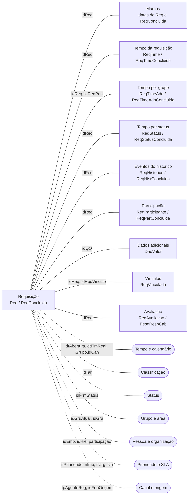

# Modelo: a requisição no centro

A requisição é o centro do modelo. Os fatos giram em volta dela e se ligam por `idReq`; as dimensões dão o recorte (quando, o quê, em que status, quem, com que prioridade, por qual canal). A [matriz fato × dimensão](matriz-fato-dimensao.md) diz por qual coluna cada cruzamento acontece.

## 1. Diagrama

Linha cheia: fato, que se liga à requisição por `idReq` (dados adicionais, por `idQQ`). Linha pontilhada: dimensão. As páginas das dimensões: [tempo e calendário](../dimensoes/tempo-calendario.md), [classificação](../dimensoes/classificacao.md), [status](../dimensoes/status-fase.md), [grupo e área](../dimensoes/grupo-area.md), [pessoa e organização](../dimensoes/pessoa-organizacao.md), [prioridade e SLA](../dimensoes/prioridade-sla.md) e [canal e origem](../dimensoes/canal-origem.md); a [ação](../dimensoes/acao.md) descreve o código de cada evento do histórico.

## 2. Granularidade de cada fato

| Fato | Uma linha por… |
|---|---|
| [Requisição](../fatos/requisicao.md) | requisição; cada requisição está em `Req` (aberta) ou em `ReqConcluida` (encerrada) |
| [Marcos](../fatos/marcos.md) | requisição; os marcos são colunas de datas de `Req` e `ReqConcluida` |
| [Tempo da requisição](../fatos/tempo-requisicao.md) | requisição (aberta em `ReqTime`, encerrada em `ReqTimeConcluida`), com os tempos gravados no último cálculo |
| [Tempo por grupo](../fatos/tempo-por-grupo.md) | requisição × participação (`idReqPart`) que constava como atendente nos registros de histórico a partir da primeira resposta, mais a do atendente atual quando há resposta |
| [Tempo por status](../fatos/tempo-por-status.md) | requisição × passagem por um status (o mesmo status pode aparecer mais de uma vez na mesma requisição) |
| [Eventos do histórico](../fatos/eventos-historico.md) | evento da requisição (`idReqHist`): uma ação, mensagem ou registro feito por alguém, ou pelo sistema, num instante |
| [Participação](../fatos/participacao.md) | requisição × participação (`idReqPart`): uma entidade (tipo e `idPart`) num papel, do início ao fim da participação |
| [Dados adicionais](../fatos/dados-adicionais.md) | valor de campo de uma requisição (`idQQ`, `idDadCon`, `nSeq`, `flgAgenda`); em campo de lista, cada item escolhido é uma linha a mais em `DadValorDominio` |
| [Vínculos](../fatos/vinculos.md) | par (requisição pai, requisição filha) em `ReqVinculada`; par em `ReqVinculadaRef` (referência, dependência, desdobramento com dependência `DESDD` e o vínculo automático da ação `VINC`) |
| [Avaliação e satisfação](../fatos/avaliacao-satisfacao.md) | `ReqAvaliacao`: requisição avaliada ou encerrada com avaliação gravada (`idReq`); `PesqRespCab`: resposta a uma pesquisa (`idResp`) |

## 3. Três pontos do modelo

### Duas tabelas de requisição

`Req` guarda as requisições abertas (em andamento) e `ReqConcluida` guarda as encerradas. Uma mesma `idReq` está em exatamente uma das duas; as tabelas são disjuntas. O volume histórico soma as duas. A maioria dos fatos tem o par aberta/encerrada (`ReqTime`/`ReqTimeConcluida`, `ReqHistorico`/`ReqHistConcluida`, `ReqParticipante`/`ReqPartConcluida`). Detalhes em [Abertas e encerradas](abertas-e-encerradas.md).

### Os tempos são gravados

Os tempos não são calculados na leitura: o cálculo de tempos os grava em `ReqTime` e `ReqTimeAdo`. Ele roda a cada registro de histórico, no encerramento, antes de a linha ser copiada para `ReqTimeConcluida`, e em algumas consultas de tempos da requisição aberta. Uma rotina agendada diária executa o cálculo em lote, que calcula as abertas sem linha em `ReqTime` e recalcula as abertas cujo `dtCalc` é de um dia de calendário anterior ao de hoje. Existe ainda uma rotina de manutenção que completa os tempos faltantes das abertas sem linha em `ReqTime`, mas o produto não a agenda nem a chama: ela só roda quando alguém a executa. `dtCalc` mostra o momento do último cálculo. Detalhes em [Tempo da requisição](../fatos/tempo-requisicao.md).

### Tipo e papel do participante são coisas diferentes

`ReqParticipante.idTpPapel` é o **tipo** do participante (usuário, grupo, hierarquia, grupo de acesso, externo…), e `idPart` aponta para a entidade conforme o tipo. O **papel** (solicitante, atendente…) vem de `idFrmPapel → FormPapel.idPapel → Papel.cdPapel`. O participante vigente tem `dtFim IS NULL`. Detalhes em [Papéis e participação](papeis-e-participacao.md).

## Veja também

- [Matriz fato × dimensão](matriz-fato-dimensao.md)
- [Regras essenciais](regras-essenciais.md)
- [Abertas e encerradas](abertas-e-encerradas.md)
- [Papéis e participação](papeis-e-participacao.md)
